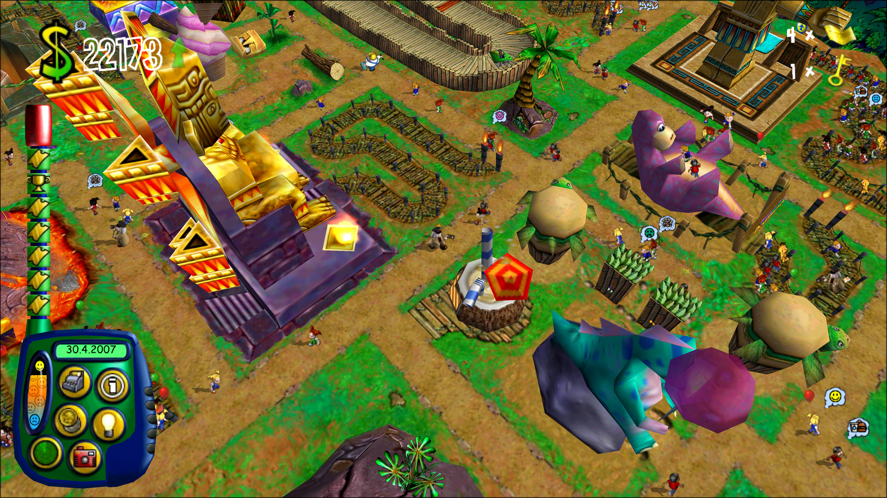
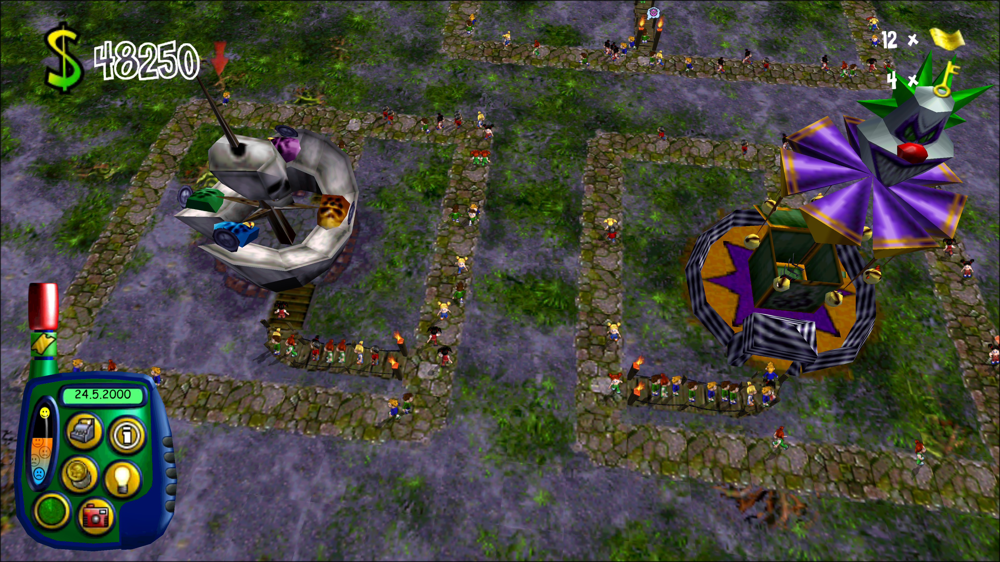
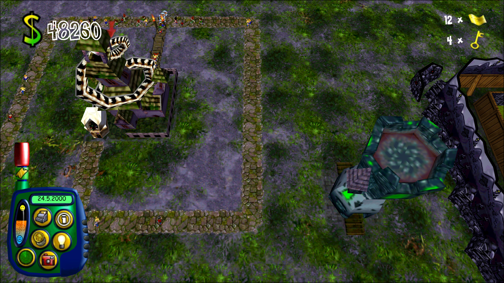
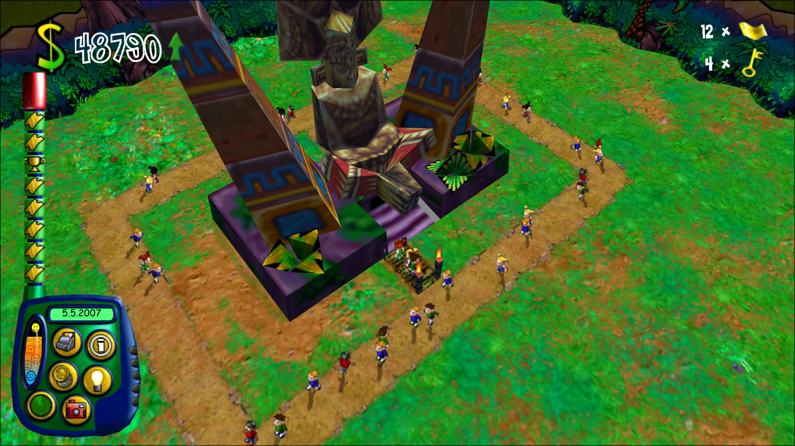
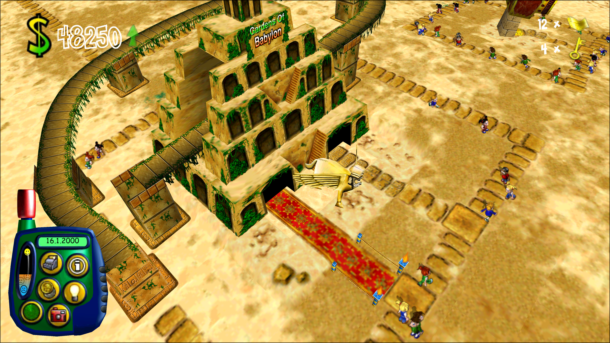
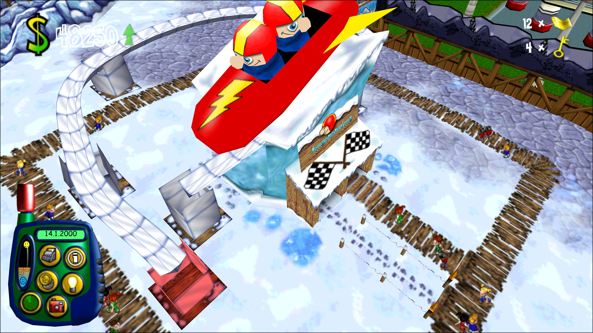
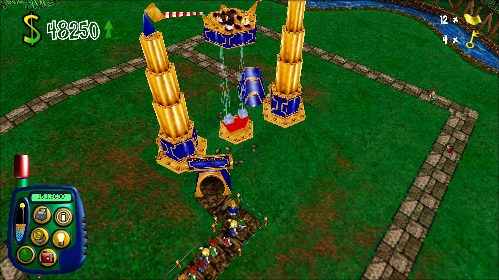

# tpw-port

[](https://discord.gg/QSvugmgCwW)

**Join the Discord: [discord.gg/QSvugmgCwW](https://discord.gg/QSvugmgCwW)**

An unofficial port of Sim Theme Park (AKA Theme Park World, 1999) for Macs (Apple Silicon and Intel), 64-bit Windows
and Linux. You need your own copy of the game.



## Quick start

To install, run the command below. To update, rerun the same command or `themepark update`.

### Windows
Run in PowerShell:

```powershell
irm https://github.com/ThemeParkWorldDecomp/tpw-port/releases/latest/download/install.ps1 | iex
```

### macOS / Linux
Run in Terminal:

```bash
curl -fsSL https://github.com/ThemeParkWorldDecomp/tpw-port/releases/latest/download/install.sh | sh
```

### Play after install

The launcher opens when the installer finishes. After that, type `themepark` in a new PowerShell or Terminal window, or
open the launcher from its install location below.

Launcher locations:
- **Windows:** `%LOCALAPPDATA%\STP-TPW-Launcher\build\tpw_launcher.exe`, also in the Start menu and Search
- **macOS:** `~/Applications/STP-TPW-Launcher/build/tpw_launcher`, also in Applications as **STP/TPW Launcher**
- **Linux:** `~/.local/share/STP-TPW-Launcher/build/tpw_launcher`, also in the applications menu

## Mods

Optional extras from [tpw-mods](https://github.com/ThemeParkWorldDecomp/tpw-mods). Open Mods, next to Settings. All are off by default, and all off is
the original game. A park saved with a mod needs it on to load.

## PS1 Exclusives







The seven rides only the PlayStation had, plus its Tower as Halloween scenery. Converted from your own USA, European or
Japanese PlayStation disc. Turn on PlayStation rides and drop the disc on the launcher.

## TPI Worlds







Three worlds from Theme Park Inc: Arabian Nights, Polar Zone and Land of Invention, with their own rides, shops and
scenery. A second ring of islands (Tab or right click) at 5, 3 and 1 golden keys. Converted from your own Theme Park Inc
disc or install. Turn on TPI Worlds and Rides and drop it on the launcher. Not publishable online.

## More mods

| Mod | What it does |
| --- | --- |
| Enable strikes | Staff can strike, as Bullfrog first wrote it. |
| Patrolling staff can cross bridges | Patrols cross footbridges. |

Every mod works on US, European and Gold.

## Playing

1. Run `themepark` (built by hand: `build/tpw_launcher`).
2. Drop your disc on the window: Mac CD, PC CD, or a zip, 7-Zip, RAR or disc image of either. Split archive: drop all
   parts, or the first.
3. Wait for the check. Press Play.

Changed files are rechecked at each start. Edited `.sam` files are kept.

Settings:

| Setting | Default | On means |
| --- | --- | --- |
| Skip the intro films | Off | Straight to the lobby. |
| Back to the launcher after playing | Off | The launcher reopens when the game quits. |
| Full screen | On | Off plays in a window. Cmd+Ctrl+F (Mac) or Alt+Enter switches. |
| Renderer (Linux) | OpenGL | Vulkan: the port's own renderer. |
| Smooth wheel zoom | Off | The wheel eases toward the pointer. |
| Zoom out further | Off | The camera goes further out. |
| Several keys at once | Off | Walk and turn at once, as on the PC. |
| W A S D move the camera | Off | W A S D scroll and walk (Z Q S D on AZERTY). A and S no longer open All items and All staff. |
| Varied sounds | On | Sounds vary, as on the PC. Off is the Mac's way. |
| Stereo panning | Off | Sounds pan with the camera. |
| Show Ride Badges | On | GOLD and PS1 badges on build-menu icons. |
| Interface size | 100% | 85% or 70% shows more park. |
| Language | The edition's own | Text and advisor voice, from your discs' languages. |
| Game options | The game's own | The game's Options panel (Config.tcf, gms.dat). Greyed while playing. |
| Graphics | Default | Eight low/med/high.sam settings. Default follows Graphics quality. |
| Frame rate limit | Monitor | 30 up to your refresh rate. |
| Check for updates | On | See Updates. |
| Online server | Empty | Automatic, or type an address. |

Check again rehashes every file.

Online account: Create account on the login panel (the lobby's globe). Password 6 to 16 characters. The e-mail is only
for resets. The 1999 game sends passwords unencrypted: use a new one. Forgot password? e-mails a code, valid 30 minutes.

### Keys

| Action | Mac | Windows and Linux |
|---|---|---|
| Help bar on/off | Cmd/Ctrl+H | Ctrl+H |
| Menu / cancel | Esc | Esc |
| Hide control panel | F3 | F3 |
| Open park | Cmd/Ctrl+O | Ctrl+O |
| Close park | Cmd/Ctrl+C | Ctrl+C |
| Buy attractions | B | B |
| Hire staff | H | H |
| Park information | I | I |
| All attractions | A | A |
| All staff | S | S |
| All visitors | V | V |
| Finances | F | F |
| Loans | L | L |
| Training budgets | T | T |
| Entry price | G | G |
| Research | R | R |
| Map | Space | Space |
| Staff locator | Cmd/Ctrl+S | Ctrl+S |
| Visitor locator | Cmd/Ctrl+V | Ctrl+V |
| Postcard | Cmd/Ctrl+P | Ctrl+P |
| Camcorder | C | C |
| Rotate camera | Left / Right | Left / Right |
| Scroll left / right | Numpad 4 / 6 | Numpad 4 / 6 |
| Scroll up / down | Numpad 8 / 2 | Numpad 8 / 2 |
| Zoom in / out | Up / Down | Up / Down |
| Back to the gates | Home or Numpad 5 | Home or Numpad 5 |
| Turn object clockwise | , (comma) | , (comma) |
| Turn object anticlockwise | . (period) | . (period) |
| Build several | Hold Cmd/Ctrl | Hold Ctrl |
| Copy an object | Cmd+click | Ctrl+click |
| Delete track section | Backspace | Backspace |
| Clear land | F7 | Delete |
| Delete path tile | Backspace | Backspace |
| Speed up time | Numpad + | Numpad + |
| Slow down time | Numpad - | Numpad - |
| Normal speed | Numpad * | Numpad * |
| Pause | P | P |
| Advisor | F1 | F1 |
| Chat hide / show | F4 | F4 |
| Chat focus | Tab, Enter or / | Tab, Enter or / |
| Send chat | Return or Enter | Enter |
| Full screen | Option+Return | Alt+Enter |
| Quit | Cmd+Q (port) | Alt+F4 (Linux also Super+Q, port) |

### Cheats

#### How to enable cheat mode

1. In a park, press G and click the park's name.
2. Rename it `Kevin the` (first line) `Cosmic Cow` (second line).
3. Press Return.

Or press Control+Shift+Option+C (Mac), Ctrl+Shift+Alt+C (Windows, Linux).

#### Cheat list

Mac keys. Windows and Linux: Option is Alt, Control is Ctrl. Tried: checked in play.

| Cheat | Keys | Tried |
| --- | --- | --- |
| +$10,000 | Option+1 | Mac |
| Complete all research | Option+R | |
| Undo that | Option+Shift+R | |
| One guest | Shift+1 | Mac |
| Five guests | Control+Shift+1 | |
| Fill every path with guests | Control+Shift+Option+1 | |
| Security guard | Shift+5 | Mac |
| Researcher | Shift+6 | Mac |
| Mechanic | Shift+7 | Mac |
| Handyman | Shift+8 | |
| Entertainer | Shift+9 | |
| One of each staff | Shift+0 | Mac |
| Litter | Shift+L | Mac |
| Vomit | Shift+V | |
| Clean all litter | Shift+Y | |
| Break the ride under the pointer | Shift+B | |
| Nothing (empty in the original) | Option+Shift+B | |
| Strikes (park 2+ years old) and a month's costs | Control+Option+S | Mac |
| Winning sequence (again to stop) | Option+Shift+1 | Mac |
| Bankruptcy sequence | Option+Shift+0 | |
| Bank loan 1 to 4 | Control+keypad 1 to 4 | |
| Golden ticket | Option+G | Mac |
| Other golden tickets | Option+keypad 1 to 9 | |
| Weather up one step (of 100) | Option+F12 | |
| Weather down one step | Option+F11 | |
| Weather up ten | Shift+F12 | |
| Weather down ten | Shift+F11 | |
| Weather off | Control+Shift+F12 | |
| Weather back to normal | Control+F12 | |
| Real-time lighting on/off | Control+Shift+Option+F12 | |
| Frame rate on/off | Control+Shift+Option+F11 | |

#### Good to know

- Clear both lines first. Capitals as shown.
- Saved with the park. The key way adds $1.
- Mac: Control or Command both work.
- Keypad cheats need a numeric keypad.
- Mac F11/F12: hold fn. Linux may grab Ctrl+Alt+F keys.
- People and mess appear at the pointer. Guest keys open a closed park.
- Golden ticket keys work without cheat mode.
- A second strikes press may not stop them.

### Updates

- Checks GitHub at start, for releases only. Sends nothing about you.
- Banner: "Version X.Y.Z is out". Update installs it (script installs) or opens the release page (built by hand).
  Flatpak: run `themepark update`.
- Off: Settings, Check for updates. Once: `tpw_launcher --check-updates`.
- The game never needs the internet.

## What you need

- macOS 11+ with `xcode-select --install`, Windows 10/11 64-bit (Arm: 11), or Linux x86-64 with OpenGL or Vulkan.
- 2.5 GB free.
- Your own disc:

| Disc | Gives |
| --- | --- |
| US Mac CD | Sim Theme Park |
| + European PC CD (2000 or later pressing) | Theme Park World |
| US Windows CD 2.0 | Sim Theme Park |
| European Windows CD | Theme Park World |
| US Windows CD 1.0 | Patch to 2.0 on Windows, then drop the installed folder with the CD |
| + PC Gold bonus CD | 18 Gold rides, 17 updated ones |

No other patches. A Gold park needs the Gold Edition switch on.

Data folder (files, saves, logs):

- Mac: `~/Library/Application Support/STP-TPW Launcher`
- Windows: `%APPDATA%\STP-TPW Launcher`
- Linux: `~/.local/share/STP-TPW Launcher`
- Flatpak: `~/.var/app/io.github.ThemeParkWorldDecomp.Launcher/data/STP-TPW Launcher`

`make clean` and `build.cmd clean` never touch it. Log: `logs/launcher.log`. About box: Show logs, Export logs. Windows has no console:
use `build\tpw_launcher.exe 2> log.txt`.

### Edited settings files

- `.sam` files live in `assets/us/Theme Park Data` and `assets/eur/Theme Park Data`. Edit freely: they are kept.
- A Customized settings badge lists them. Restore original puts the disc's copy back.
- A line the game can't read can crash it. The list warns you.

## Asset packs

- A zip of replacement files at their game paths, e.g. `data/init/640/Splash_American.tga`.
- Put it in `packs` in the data folder, or pass `--packs DIR`. Later names win.
- Allowed: `.tga`, `.wct`, `.ani`, `.cur`, `.sf2`, `.sdt` with `.map`, `.ttf`, `.bf4`, `.mov`. No `.sam`.
- Ignored: zips starting with a dot, packs over 8 GB. The log says why.
- Use the game's formats (uncompressed TGA). Replace all three logo folders (`640`, `800`, `1024`). A new
  `welcome.tga` must be at least as wide as `legal.tga`.
- A broken file can crash the game.

## Where it stands

- Every function is translated. Both editions play.
- 158 stand-ins remain, none reached in play.
- Online play works on a revived server. Mail and postcards don't yet.

## For developers

### The code

- [tpw-decomp](https://github.com/ThemeParkWorldDecomp/tpw-decomp) submodule: the translated game, bugs included.
- launcher/: the launcher. launcher/net/ is the only internet code.
- platform/: Mac and Windows shims on SDL3 and OpenGL. platform/vulkan/: the Linux Vulkan renderer.
- overrides/: 549 fixes, listed in [FIXES.md](FIXES.md).
- mods/: the [tpw-mods](https://github.com/ThemeParkWorldDecomp/tpw-mods) submodule, via TPW_MOD_HOOK. `-DTPW_MODS_DIR=<folder>` points elsewhere.

### The Windows build

- `.\build.cmd` fetches pinned tools, or uses yours: clang 23.1.3+ (llvm-mingw), CMake 3.20+, Ninja 1.10+, Python 3.10+.
- `.\build.cmd TOOLS=fetch` always fetches. `.\build.cmd test` runs the tests. `BUILD=<folder>` picks the folder.
- Logs: build\logs\.
- Platform tests need `-DTPW_LIBCLANG=<path>`.

### The Linux build

- Tested on Ubuntu 24.04 (GCC 13.3, clang 18.1) and Arch (KDE, Wayland, NVIDIA).
- `--renderer vulkan` falls back to OpenGL without a Vulkan device. No Vulkan package needed to build.
- After a shader change, run `devtools/vulkan_shaders.sh`.
- Platform tests need libclang (libclang-18-dev, or `-DTPW_LIBCLANG=<path>`).
- `install.sh --flatpak` installs the Flatpak instead.

### Building by hand

Needs CMake 3.20+, a C++17 compiler, Python 3.

    git clone --recurse-submodules https://github.com/ThemeParkWorldDecomp/tpw-port.git
    cd tpw-port
    cmake -S . -B build
    cmake --build build -j8 --target tpw_launcher

- `make` takes BUILD=, CMAKE=, JOBS=. `make clean` deletes build/.
- `-DTPW_MOVIES=OFF`: no films.
- Local-folder clone: `git -c protocol.file.allow=always submodule update --init`.

Windows, with llvm-mingw in C:\llvm-mingw (PowerShell):

    git -c core.autocrlf=false clone --recurse-submodules https://github.com/ThemeParkWorldDecomp/tpw-port.git
    cd tpw-port
    $env:PATH = "C:\llvm-mingw\bin;$env:PATH"
    cmake -S . -B build -G Ninja -DCMAKE_C_COMPILER=clang -DCMAKE_CXX_COMPILER=clang++
    cmake --build build --target tpw_launcher
    build\tpw_launcher.exe

### Building on Linux

The installer does this. By hand: GCC 13 or clang 18+, CMake 3.20+, Ninja, Python 3, SDL's dev packages.

Debian and Ubuntu:

    sudo apt install build-essential cmake ninja-build python3 git \
        libx11-dev libxext-dev libxrandr-dev libxcursor-dev libxi-dev libxfixes-dev libxss-dev libxkbcommon-dev \
        libwayland-dev wayland-protocols libdecor-0-dev libegl1-mesa-dev libgl1-mesa-dev libdrm-dev libgbm-dev \
        libasound2-dev libpulse-dev libpipewire-0.3-dev libdbus-1-dev libudev-dev libibus-1.0-dev

Fedora:

    sudo dnf install gcc gcc-c++ libstdc++-static make cmake ninja-build python3 git \
        libX11-devel libXext-devel libXrandr-devel libXcursor-devel libXi-devel libXfixes-devel libXScrnSaver-devel \
        libxkbcommon-devel wayland-devel wayland-protocols-devel libdecor-devel mesa-libEGL-devel mesa-libGL-devel \
        libdrm-devel mesa-libgbm-devel alsa-lib-devel pulseaudio-libs-devel pipewire-devel dbus-devel systemd-devel \
        ibus-devel

Arch (run `sudo pacman -Syu` first):

    sudo pacman -S --needed gcc make cmake ninja python git pkgconf libx11 libxext libxrandr libxcursor libxi \
        libxfixes libxss libxkbcommon wayland wayland-protocols libdecor libglvnd mesa libdrm alsa-lib libpulse \
        libpipewire dbus systemd-libs libibus

Then:

    git clone --branch stable --recurse-submodules https://github.com/ThemeParkWorldDecomp/tpw-port.git
    cd tpw-port
    cmake -S . -B build -G Ninja
    cmake --build build --target tpw_launcher
    build/tpw_launcher

- Update: `git pull`, `git submodule update --init --recursive`, then the two cmake lines.
- `-DTPW_STATIC_RUNTIME=OFF` uses the system C++ runtime.
- `make`, `make run`, `make test`, `make clean` work too.
- Flatpak bundle: `sh devtools/flatpak.sh`.
- Headless tests: `SDL_AUDIO_DRIVER=dummy`, `xvfb-run`.

### Game data from the command line

    python3 tpw-port/devtools/import_originals.py --from ORIGINALS --to extracted
    tpw-port/build/tpw_launcher --game "extracted/disc-hfs/Theme Park Data"

- Takes the US Mac CD image, optionally the European PC ISO and the Bonus Stuff zip. Ends with "CHECK OK".
- `--find` lists finds. `--check extracted` rechecks. `--whole-disc` adds the CD's extras.
- `tpw_launcher --play us` (eur, us-pc, eur-pc) skips the window. `--no-preload` stops read-ahead. `--help` lists all.

### Running from the command line

    tpw-port/devtools/run_launcher.sh tpw-port/build NAME SECONDS [options]

- Own user folder (build/user-NAME) and log (build/launch-NAME.log). Quits after SECONDS.
- Options: --mute, --no-movies, --windowed, --display builtin, --background, --launcher-window, --play us|eur,
  --data DIR.
- Input: --click X,Y@PASS, --type TEXT@PASS, --drag X0,Y0-X1,Y1@PASS, --frames N, --window-click X,Y@FRAME,
  --window-size WxH, --fullscreen.
- Defaults to --aspect 4:3 --resolution 2048x1536. `--paced` unsets TPW_VSYNC_EVERY_REFRESH.

### Widescreen and resolution

- Fills the screen at its shape (4:3, 16:10, 16:9). No bars.
- `--windowed`: a window. `--background`: behind other windows.
- Animations keep pace at any frame rate.
- Options panel, Screen resolution: change size and shape while playing.
- `--resolution 2048x1536`: the original's largest 4:3 size. `--aspect 4:3`: the original layout.

## Reporting a problem

Open an issue or post on [Discord](https://discord.gg/QSvugmgCwW) with:

1. The launcher version (`tpw_launcher --version`). For -dev, the log's `build: ...` line.
2. Your system and edition.
3. The log: About box, Export logs. It holds no user names.
4. What you did.

Update to the newest release first.

## Contributing

The project is three repositories, and every change belongs in exactly one of them:

| Repository | What it holds | Pull requests |
| --- | --- | --- |
| [tpw-decomp](https://github.com/ThemeParkWorldDecomp/tpw-decomp) | The translation: the Mac program's own functions in C++, each behaving exactly as the Mac build does, bugs included, with the differential tests that check it. | None. A function that behaves differently from the Mac is reported as an issue on tpw-port. |
| [tpw-port](https://github.com/ThemeParkWorldDecomp/tpw-port) | The original game on today's Macs, Windows PCs and Linux machines: the launcher, the platform layer, the builds, and the fixes that make it run as it did on the Mac. | Welcome, by its CONTRIBUTING.md. |
| [tpw-mods](https://github.com/ThemeParkWorldDecomp/tpw-mods) | Optional changes to how the game plays, each one off until the player turns it on. tpw-port carries it as a submodule at mods/. | Welcome, by its CONTRIBUTING.md. |

The test for where a change goes: does a park play the same with it on and with it off? If it does, the change belongs in
tpw-port. If it changes the rules, the money, the visitors, the staff, the rides, the advisor, the game's content, what a
control does or the save files, it belongs in tpw-mods, even as a setting that is off by default.

One exception: an option the original game already had in its .sam data files belongs in tpw-port, even when it
changes how a park plays, as long as it offers only the values the original accepts and its default is the original's.
Players set it in the launcher or a game menu, never by editing a .sam file.

Two additions to the game's own screens. The online login panel has a "Create account" button, a sign-up popup and a
password reset ("Forgot password?"), drawn in the game's own style. The original made accounts and reset passwords on
EA's website, which is gone. It belongs in tpw-port, and with the port's fixes off the panel is the original's. And
Buy Ride's picture of a ride the Gold Edition added has a small "GOLD" badge, display only, so players can tell those
rides apart. It belongs in tpw-port too, and the launcher's Settings switch "Show Ride Badges" (on by default) turns it
off. The "PS1" badge on the PlayStation rides is the tpw-mods PlayStation rides mod's own and follows the same switch.

Pull requests welcome. Rules: [CONTRIBUTING.md](CONTRIBUTING.md).

- Pull requests go to main, always the next -dev version.
- A release is a vX.Y.Z tag. Releases never change.
- CI builds every push on Windows, macOS and Ubuntu.

Thanks: samueleagle91 (spamaerie) made the Windows build. slappyhead first ran it on an Intel Mac.

## See also

- [tpw-decomp](https://github.com/ThemeParkWorldDecomp/tpw-decomp): the translation.
- [tpw-mods](https://github.com/ThemeParkWorldDecomp/tpw-mods): the mods.
- [CHANGELOG.md](CHANGELOG.md): what's new.
- [FIXES.md](FIXES.md): every change from the Mac original.

No license yet for the port's own code. Bundled:

- FFmpeg 9.0.2, LGPL 2.1+ (third_party/ffmpeg/COPYING.LGPLv2.1, NOTE.md). Built from source, so you can rebuild it.
- SDL3 3.2.30, zlib 1.3.2 (zlib License), libjpeg 6b (IJG License).
- libarchive 3.8.11 (BSD 2-Clause, tpw-decomp/third_party/libarchive/COPYING).
- liblzma, XZ Utils 5.8.4 (0BSD, tpw-decomp/third_party/xz/COPYING.0BSD).
- Fredoka and Nunito fonts (OFL 1.1, third_party/fonts). stb_truetype, stb_rect_pack (MIT or public domain).

libarchive's licence, as its COPYING gives it (each of its files names its own authors):

```
Copyright (c) 2003-2018 <author(s)>
All rights reserved.

Redistribution and use in source and binary forms, with or without
modification, are permitted provided that the following conditions
are met:
1. Redistributions of source code must retain the above copyright
   notice, this list of conditions and the following disclaimer
   in this position and unchanged.
2. Redistributions in binary form must reproduce the above copyright
   notice, this list of conditions and the following disclaimer in the
   documentation and/or other materials provided with the distribution.

THIS SOFTWARE IS PROVIDED BY THE AUTHOR(S) ``AS IS'' AND ANY EXPRESS OR
IMPLIED WARRANTIES, INCLUDING, BUT NOT LIMITED TO, THE IMPLIED WARRANTIES
OF MERCHANTABILITY AND FITNESS FOR A PARTICULAR PURPOSE ARE DISCLAIMED.
IN NO EVENT SHALL THE AUTHOR(S) BE LIABLE FOR ANY DIRECT, INDIRECT,
INCIDENTAL, SPECIAL, EXEMPLARY, OR CONSEQUENTIAL DAMAGES (INCLUDING, BUT
NOT LIMITED TO, PROCUREMENT OF SUBSTITUTE GOODS OR SERVICES; LOSS OF USE,
DATA, OR PROFITS; OR BUSINESS INTERRUPTION) HOWEVER CAUSED AND ON ANY
THEORY OF LIABILITY, WHETHER IN CONTRACT, STRICT LIABILITY, OR TORT
(INCLUDING NEGLIGENCE OR OTHERWISE) ARISING IN ANY WAY OUT OF THE USE OF
THIS SOFTWARE, EVEN IF ADVISED OF THE POSSIBILITY OF SUCH DAMAGE.
```
